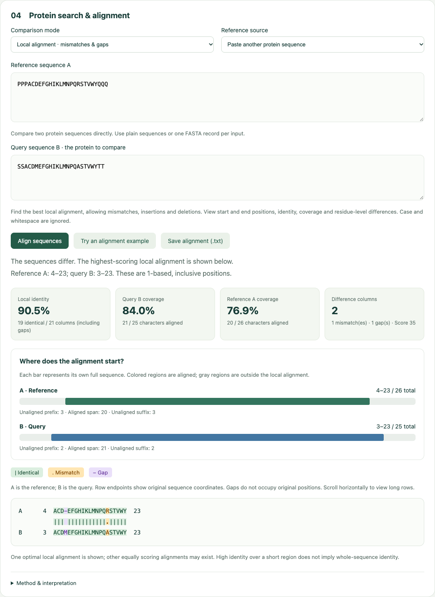

# GooseCode

A local DNA-to-protein tool with amino-acid search and visual pairwise alignment. Import a SnapGene `.dna` file or paste DNA, transcribe it to RNA, translate a selected interval, and export the results. The same plain HTML/CSS/JavaScript application runs in a browser or inside the standalone macOS app.

Current working copy: **1.3.0 + unreleased changes**, including multi-record DNA FASTA, pasted DNA and static website preparation. Use the local source or `dev/GooseCode.app`. The browser deployment files can be prepared in `dist/web/`; no live website or new macOS release is assumed here.



## Features

- Import SnapGene `.dna`, single- or multi-record DNA FASTA, or plain DNA text.
- Paste plain DNA or single-/multi-record DNA FASTA directly into **Import**, then click **Use pasted DNA** to translate it immediately.
- Concatenate multi-record FASTA DNA in file order, then transcribe and translate one continuous sequence.
- Select a strand, interval, reading frame, and stop-codon policy.
- Export RNA FASTA, protein FASTA, or GenPept-style `.gp` files.
- Send the merged protein directly to reference A for amino-acid search and alignment; export each merged result as one record.
- Search for every exact amino-acid match, including overlapping hits, and export positions as TSV.
- Compare two proteins with Smith–Waterman local alignment, including mismatches and gaps.
- Visualize alignment start/end coordinates, matching regions, identity, and coverage; export the full alignment as TXT.
- Process sequences locally, without accounts, sequence uploads, a backend, or a database.
- Watch a swimming goose reveal amino-acid beads behind a DNA helix; animation respects reduced-motion preferences and stops while offscreen or in the background.

## Run in a browser

For a hosted copy, visit its URL in Microsoft Edge, Google Chrome or Firefox on Windows, Linux or macOS. Users need only a browser: no installation, Node.js, Python or macOS wrapper is required. No deployment URL has been configured for this working copy yet.

For local use, open [index.html](index.html) directly. Keep the shared HTML, JavaScript, CSS and `assets/` in their original directory structure. A downloaded source folder can run without an internet connection or a build step.

To prepare the static files for GitHub Pages or another static host, run `python3 scripts/prepare_web.py` (or `npm run build:web`). This copies the shared runtime and samples unchanged into `dist/web/`, without the Swift wrapper or development tools. See [static website preparation and deployment](docs/WEB_DEPLOYMENT.md).

Once a hosted page and its resources have loaded, sequence processing and exports continue offline in that open page. Offline reloads and new sessions are not guaranteed: there is no service worker or PWA cache. Loading a hosted page requests static application files; DNA and protein inputs are processed in browser memory and are not uploaded.

Click **Try an example**, or import the included `example.dna`. With the default settings, `ATGGCTTGTAAATGA` produces RNA `AUGGCUUGUAAAUGA` and protein `MACK`.

You can also paste that sequence into the DNA text box in **Import** and click **Use pasted DNA**. Pasted input accepts the same DNA letters and FASTA records as text files, up to 10 MiB of UTF-8 text. Editing it clears DNA-derived results until you import it again. See [pasting DNA](docs/USER_GUIDE.md#paste-dna) for details.

The swimming goose animates automatically as an illustration. It does not visualize the imported sequence or calculation progress. It respects the system's reduced-motion preference and stops while offscreen or in a background tab.

## Run the macOS app

Open the current local app at `dev/GooseCode.app`. It includes the multi-record DNA concatenation workflow described below. The app is self-contained and can run without the source folder.

Requires macOS 12 or later. The default build includes Apple Silicon and Intel binaries. Apple Silicon has been tested; Intel has been compiled and statically checked, but not tested on Intel hardware. The app uses a local ad-hoc signature and is **not Apple-notarized**; a downloaded copy may show a developer-verification prompt.

To rebuild the local app from source on a Mac with Apple Command Line Tools installed:

```sh
bash macos/build.sh --dev
```

This creates or replaces only `dev/GooseCode.app`; it creates no release ZIP. A fresh source checkout needs this build step before the native app is available. See [macOS packaging and signing](macos/README.md) for details.

## Multi-record FASTA

Importing multi-record FASTA concatenates every DNA record in file order without separators, including records with duplicate IDs. The app shows the record count and total DNA length, then automatically produces one RNA sequence and one protein sequence. There is no record selector or separate batch step.

Start/End coordinates refer to the joined DNA. The strand, reading frame and stop policy apply once to that combined sequence; codons may cross record boundaries. Reverse-complement mode reverses the complete selected interval after joining. **Stop at the first stop codon** remains enabled by default: clear it and run the translation again to include sequence beyond the first stop, retaining stops as `*`.

The merged protein automatically becomes reference A in section **04**. Enter a query protein to search or align against it. RNA FASTA, protein FASTA and GenPept saves each contain one combined record with concatenation metadata. This operation joins DNA directly; it does not infer sequence overlaps or a biological assembly. Try the [multi-record example](examples/multi-record.fasta), and see the [user guide](docs/USER_GUIDE.md#multi-record-fasta) for coordinate details.

## Files and documentation

| Path | Contents |
| --- | --- |
| `index.html`, `core.js`, `app.js` | Browser interface and sequence processing |
| `sequence-swim.css`, `sequence-swim.js`, `assets/` | Offline goose animation and GooseCode icon artwork |
| `example.dna`, `examples/` | Synthetic sequence examples |
| `dev/GooseCode.app` | Current local macOS app; excluded from source packages |
| `dist/web/` | Generated static website; excluded from source control |
| `.github/workflows/pages.yml` | GitHub Pages deployment workflow |
| `macos/`, `scripts/`, `tests/` | Native source, packaging scripts and tests |
| `docs/`, `README.md`, `CONTRIBUTING.md`, `CHANGELOG.md` | English instructions and project history |

Start with the [user guide](docs/USER_GUIDE.md). Current previews show the [merged sequence workflow](docs/screenshots/merged-sequence.png) and [swimming goose](docs/screenshots/swimming-goose.png). The ignored `macos/.build/` cache is regenerated when building. `dist/` contains generated outputs such as the static website; release ZIPs are prepared separately.

## Interpretation and limits

Translation uses the standard genetic code (NCBI table 1). Select the coding interval yourself: the tool does not identify CDS features, predict genes, splice introns, or translate across the end of a circular sequence.

Local alignment uses literal match `+2`, mismatch `−1`, and a linear gap penalty of `−2`. It reports one best local result, not a global alignment or a statistical test of homology. Inspect alignment length and coverage alongside identity.

Local alignment accepts up to **200,000 characters per sequence**, with a length product of **80,000,000 or less**, including equality (for example, `10,000 × 8,000`). Inputs above these limits are rejected rather than truncated. At the product limit, traceback storage alone uses about 80 MB; larger products also require more computation. Progress and cancellation are available.

Sequences and results are held in memory. Export anything you want to keep before refreshing the page or quitting the app. See the [user guide](docs/USER_GUIDE.md) for input formats, coordinates, visualization, and scientific limitations.

## Development

Run the core tests with Node.js:

```sh
node --test tests/*.test.js
```

Install the browser-test dependency and Chromium, then run the browser smoke test:

```sh
npm install
npx playwright install chromium
npm run test:browser
npm run test:browser:fasta
npm run build:web
npm run test:web
```

The hosted browser test serves the generated files from `/GooseCode/` through a test-only loopback server. It checks imports, translation, comparison, cancellation, downloads, refresh behavior, local processing and relative resource paths. The application itself has no npm runtime dependencies or application server. Browser targets do not imply every browser/operating-system combination has been tested; see [development and browser checks](CONTRIBUTING.md#tests). See also the [changelog](CHANGELOG.md).

## Publication status

No GitHub repository, live Pages URL or new release is configured by local preparation. A license has not yet been selected. Choose and add a `LICENSE` file before publishing. Follow the [static website guide](docs/WEB_DEPLOYMENT.md) to deploy the browser version, or [release preparation](CONTRIBUTING.md#before-publishing-to-github) and the [GitHub release SOP](docs/GITHUB_RELEASE_SOP.md) to distribute a macOS release. These are separate publication steps.
